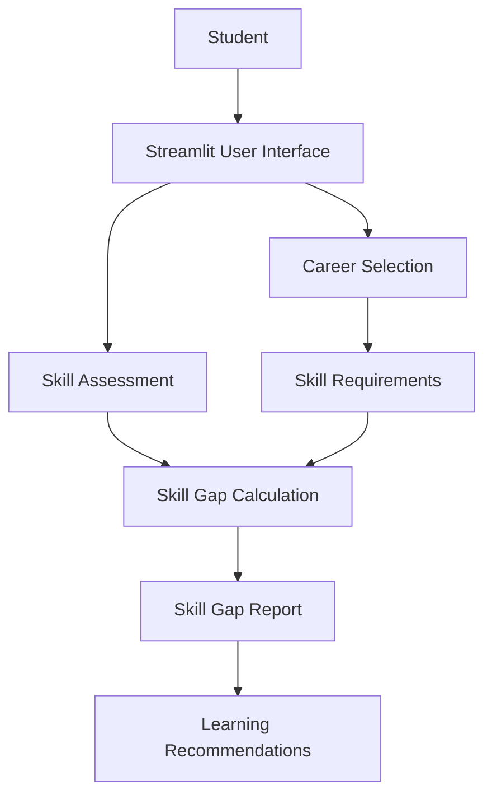

# Technical Design Document

## Project: Bridging the Academic Skill Gap

**Team Name:** RTC Dominators  
**Team ID:** HSC|TN|01007  
**State:** Tamil Nadu

## 1. Introduction

Bridging the Academic Skill Gap is a web application designed to help students compare their current skill levels with the target skills required for selected careers.

## 2. System Architecture

The application follows a simple web application architecture.

## 3. Technology Stack

- **Programming language:** Python
- **User interface:** Streamlit
- **Skill calculation:** Python application logic
- **Source code repository:** GitHub
- **Deployment:** Streamlit Community Cloud

## 4. Main Components

### 4.1 User Interface

Allows students to select a career, rate their skills, and view results.

### 4.2 Career Requirements

Stores target skill levels for each supported career, including Software Developer, Data Analyst, and AI Engineer.

### 4.3 Skill Gap Calculator

For each skill, the gap is calculated as:

`Skill Gap = max(0, Required Level - Current Level)`

The current prototype sums the individual skill gaps to display a total gap score.

### 4.4 Recommendation Module

Provides general learning suggestions for skills whose current levels are below the target levels.

### 4.5 Results Module

Displays current levels, target levels, individual skill gaps, and a total gap score.

## 5. Application Workflow

1. Student opens the application.
2. Student chooses a career goal.
3. Application displays relevant skills.
4. Student rates each skill from 1 to 5.
5. The application calculates individual skill gaps.
6. The results and learning suggestions are displayed.

## 6. Data Management

Career requirements are currently stored in the Python source code. The current prototype does not use a database or persist student assessments between sessions.

## 7. Security and Privacy

The prototype does not require passwords, API keys, or personal student records. Avoid entering sensitive personal information. If data storage or authentication is introduced later, appropriate access controls and privacy protections must be implemented.

## 8. Limitations

- Career requirements are illustrative and should be validated against industry expectations.
- Learning suggestions are general rather than dynamically personalized.
- Student progress is not saved between sessions.
- The total gap is a simple sum and is not a validated measure of employability.

## 9. Future Enhancements

- Add verified industry skill frameworks.
- Integrate curated learning resources.
- Store progress securely with student consent.
- Introduce more career pathways.
- Add automated testing and personalized learning plans.

## 10. Conclusion

The prototype demonstrates a basic approach to identifying skill gaps and helping students plan their learning. Further validation and development are needed before using it for real career assessments.
